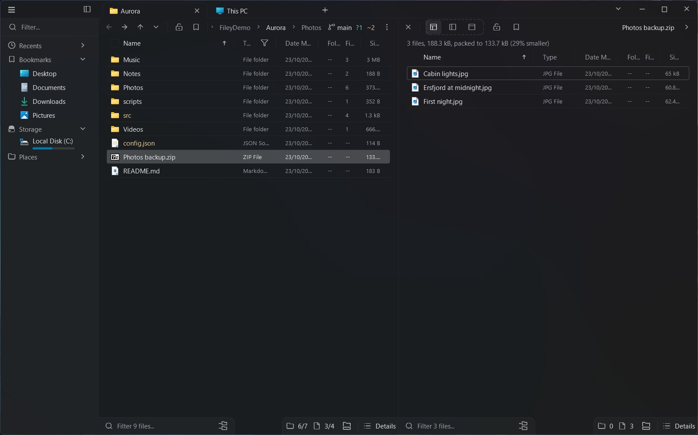

<h1 align="center"> Filey</h1>

<p align="center">A fast, keyboard-first file manager for Windows and Linux, written in C.</p>

> [!IMPORTANT]
> Filey is heavily inspired by [File Pilot](https://filepilot.tech/) and is a vibe-coded project.
> If you care about hand-crafted software, use File Pilot instead, or better, buy it.
> Developers like Vjekoslav Krajačić, who build amazing apps like it by hand, deserve our support.



## Features

- **Panels and tabs**: split panels side by side or stacked, tabs that move between panels and windows, and layouts you can save and restore.
- **Fast lists**: details, list, columns and icon views with thumbnails, folder sizes, filters as you type, an expanded search through subfolders, and Miller columns.
- **Go To and the command palette**: jump to recent, bookmarked or typed paths, and run any command by name. Every hotkey can be changed.
- **Inspector**: previews text with syntax highlighting and line numbers, images, PDFs, 3D models (OBJ, STL, PLY, glTF, FBX, .blend, USD), Word and Excel text, archives, and any file as hex.
- **Archives as folders**: browse zip, 7z, rar, tar and cab files, and drag, copy and paste in and out of them.
- **Git**: the branch, the commits to push and pull, the changed files colored in the list, branch switching and a safe pull that only fast-forwards.
- **Themes**: Catppuccin, Nord, Gruvbox, Tokyo Night, One Dark, Dracula, Solarized and Rosé Pine built in, schemes of your own, light and dark following the system, and a transparent glass look.
- **Languages**: English and Russian, plus your own through a translation file.

## Optional tools

Filey uses these when they are on your `PATH`. Without them, their features just stay hidden.

| Tool | What it adds |
| --- | --- |
| [FFmpeg](https://ffmpeg.org/) (`ffmpeg`, `ffprobe`, `ffplay`) | Audio waveforms you can play and scrub in the inspector, video frames, media details, and **Compress Video**, which encodes on the graphics card (NVENC, AMF or Quick Sync) when it can. |
| [yt-dlp](https://github.com/yt-dlp/yt-dlp) | Paste a video's web address into a folder to download it there, as MP4 or audio only. |
| [aria2](https://aria2.github.io/) (`aria2c`) | Download torrents: paste a magnet link, or open a `.torrent` when no torrent app is set for it. |
| [Git](https://git-scm.com/) | The Git features above. It never asks for a login: a repository that needs one is left alone. |

## Install

### Windows

Download `Filey-<version>-windows-x64.zip` from [Releases](https://github.com/Solessfir/Filey/releases), unzip it and run `Filey.exe`.
**Filey Setup** in the main menu installs it for your user, with shortcuts, the `PATH` entry, and the option to make it your default file manager.

### Linux

Installs the latest release for your user (`~/.local/bin`, with a desktop entry and icons). It needs Wayland, `freetype2` and `fontconfig`, and `libarchive` for archives.

```sh
curl -sSL https://raw.githubusercontent.com/Solessfir/Filey/main/install.sh | bash -s install
```

To uninstall it (your settings in `~/.config/filey` stay):

```sh
curl -sSL https://raw.githubusercontent.com/Solessfir/Filey/main/install.sh | bash -s uninstall
```

`wget -qO-` works in place of `curl -sSL` in both.

## Build

Filey builds with Clang 19 or later (`-std=c23`).

- **Windows**: install Visual Studio Build Tools with the C++ Clang tools, then run `Build.bat release`.
- **Linux**: install `clang`, `pkg-config` and the development packages of `wayland`, `libxkbcommon`, EGL, `freetype2` and `fontconfig`, then run `./Build.sh release`. `./Build.sh release install` installs your build for your user.

Add `test` to either command to run the tests. The build goes to `Bin/release`.

## License

Licensed under the [MIT License](LICENSE).
