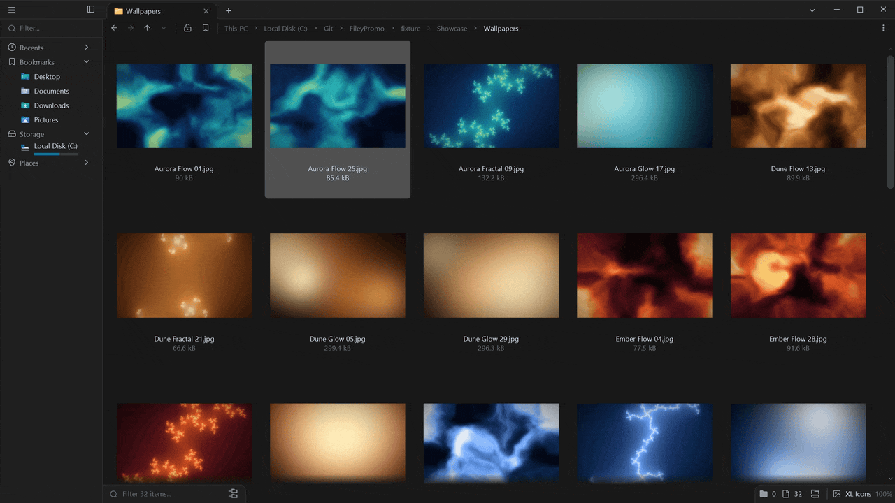

<h1 align="center"> Filey</h1>

<p align="center">A fast, keyboard-first file manager for Windows and Linux, written in C.</p>

> [!IMPORTANT]
> Filey is heavily inspired by [File Pilot](https://filepilot.tech/) and is a vibe-coded project.
> If you care about hand-crafted software, use File Pilot instead, or better, buy it.
> Developers like Vjekoslav Krajačić, who build amazing apps like it by hand, deserve our support.



## Features

**Browsing**
- Split panels and tabs, with layouts you can save and restore
- Details, list, icon and Miller column views, with thumbnails and folder sizes
- Filter as you type, or search through subfolders
- Tree view, grouping by name, type, date or size
- Archives (zip, 7z, rar, tar, cab) open as folders, even archives inside archives
- Hold a drag over a folder, in the list, the sidebar or the path, to open it and drop deeper

**Keyboard**
- Go To (Alt+E) for recent, bookmarked or typed paths
- A command palette that runs any command by name
- The sidebar works from the keyboard too (Alt+Q)
- Every hotkey can be changed
- Optional quick actions in the right-click menu: cut, copy, rename and delete by the pointer

**Inspector**
- Previews of text with syntax highlighting, images, SVG, PDF, Word, Excel, archives and hex
- 3D models: OBJ, STL, PLY, glTF, FBX, .blend, USD, Collada, 3DS, 3MF
- Audio waveforms and tags, video frames
- Disk usage as a treemap
- File details: path, size, dates, hard links, picture size

**More**
- Git status in the list, branch switching and a safe pull
- OneDrive, Google Drive, iCloud Drive and MEGA in Places, and optionally Explorer's pinned folders under Bookmarks
- Network shares, phones and cameras, and on Linux `sftp://`, `smb://`, `ftp://` and WebDAV
- Themes (Catppuccin, Nord, Gruvbox, Tokyo Night, One Dark, Filey Dark), your own schemes and a glass look
- English, Chinese, French, German, Polish, Portuguese, Russian and Spanish, or your own translation
- Linux desktop integration: Show in Folder, Templates, Open With, Nemo actions, Open as Root
- An [MCP server](#ai-agents-mcp) for AI agents (`filey --mcp`)

## Optional tools

Filey uses these when they are on your `PATH`. Without them, their features just stay hidden.

| Tool | What it adds |
| --- | --- |
| [FFmpeg](https://ffmpeg.org/) (`ffmpeg`, `ffprobe`) | Audio playback, waveforms, tags and covers, **Convert Audio** (MP3, AAC, Opus, FLAC), video frames and details, and **Compress Video** on the graphics card. |
| [yt-dlp](https://github.com/yt-dlp/yt-dlp) | Paste a video's web address into a folder to download it. |
| [aria2](https://aria2.github.io/) (`aria2c`) | Torrents: paste a magnet link, pick the files and download. |
| [Git](https://git-scm.com/) | The Git features above. |

## Install

### Windows

Download `Filey-<version>-windows-x64.zip` from [Releases](https://github.com/Solessfir/Filey/releases), unzip it and run `Filey.exe`.
**Filey Setup** in the main menu installs it for your user, with shortcuts, the `PATH` entry, and the option to make it your default file manager. On Windows 11 builds that start Explorer ahead of time, which keeps Win+E for itself, the default also takes Win+E over with a small `filey --hotkey` process started at sign-in, from the next sign-in or restart on.

### Linux

Installs the latest release for your user (`~/.local/bin`, with a desktop entry and icons), and makes it the file manager other programs open for Show in Folder. It needs Wayland, `freetype2` and `fontconfig`, and `libarchive` for archives.

```sh
curl -sSL https://raw.githubusercontent.com/Solessfir/Filey/main/install.sh | bash -s install
```

To uninstall it (your settings in `~/.config/filey` stay):

```sh
curl -sSL https://raw.githubusercontent.com/Solessfir/Filey/main/install.sh | bash -s uninstall
```

`wget -qO-` works in place of `curl -sSL` in both.

### Command line

`filey <folder or file>...` opens each in a new tab of the open window, a file in its folder with it selected. `--replace` shows the first in the current tab instead, `--split` (or `--split=bottom`) opens each in a new panel beside the current one, `--inspect` opens the inspector on a file given, and `--new-window` opens a window of its own. `filey --help` lists the options and starts nothing.

### AI agents (MCP)

`filey --mcp` is an [MCP](https://modelcontextprotocol.io) server over standard input and output, through which an agent sees what Filey shows and acts in it. Turn on **Agent Access** in the Options (or `mcp = on` in `Settings.conf`), then add it to your agent, for example in Claude Code:

```
claude mcp add filey -- filey --mcp
```

Its tools are `get_state` (the folder shown, the focused item, the selection, the tabs and panels), `open_path` (show a folder, in a new tab if asked, with items selected, or a file in its folder), `select`, `list_commands` and `run_command` (any of Filey's commands by name, as its hotkey would; destructive ones still ask in the window), and `search` (Go To's search of the drives, places, bookmarks, recents and the drive index). The server talks to the open window, starting Filey when it is not running, over a channel only your user can reach.

### Updates

Filey asks GitHub once a day whether a newer release is out (with `curl`, which Windows 10 and later and Linux desktops have). When one is, a notice and the main menu offer **Update**, which downloads it, puts it in place of the running Filey and starts it again with your panels and tabs. **Update Check** in the Options turns the daily check off; **Check For Updates** in the command palette asks at once.

### Colors from your wallpaper

Filey takes its colors from your wallpaper through [Matugen](https://github.com/InioX/matugen). In Options, duplicate any color scheme: the copy is a custom scheme, `Custom1.scheme` in `~/.config/filey`, and is chosen at once. Get the template:

```sh
mkdir -p ~/.config/matugen/templates
curl -sSL https://raw.githubusercontent.com/Solessfir/Filey/main/Source/Resources/filey-matugen.conf -o ~/.config/matugen/templates/filey.conf
```

Then point Matugen at that scheme in `~/.config/matugen/config.toml`:

```toml
[templates.filey]
input_path = '~/.config/matugen/templates/filey.conf'
output_path = '~/.config/filey/Custom1.scheme'
```

Each time Matugen runs, Filey takes the new colors at once.

## Build

Filey builds with Clang 19 or later (`-std=c23`).

- **Windows**: install Visual Studio Build Tools with the C++ Clang tools, then run `Build.bat release`.
- **Linux**: install `clang`, `pkg-config` and the development packages of `wayland`, `libxkbcommon`, EGL, `freetype2` and `fontconfig`, then run `./Build.sh release`. `./Build.sh release install` installs your build for your user.

Add `test` to either command to run the tests. The build goes to `Bin/release`.

## License

Licensed under the [MIT License](LICENSE).
